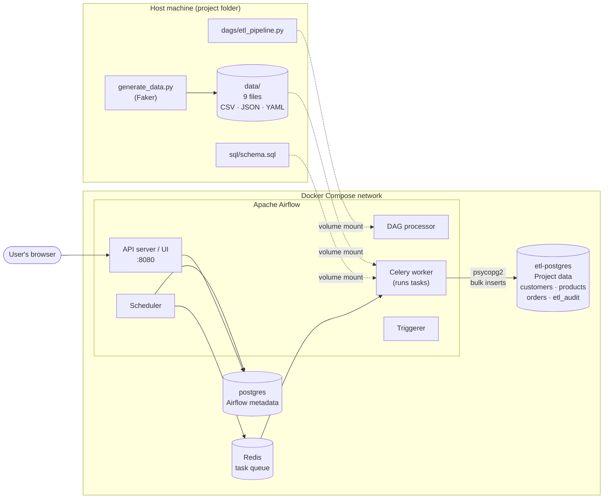
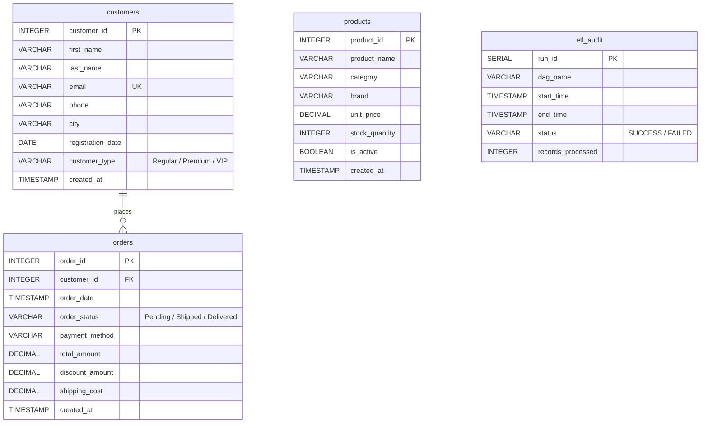
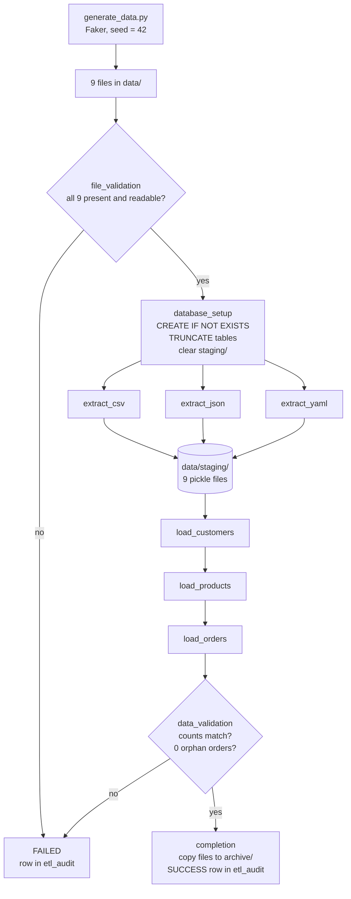

# Technical Documentation: Rapid ETL Pipeline

**Course:** DATA 430 – Data Engineering Practicum · **Project 1**
**Author:** Ahmed · **Orchestration:** Apache Airflow (Option A)

---

## Contents

1. System Architecture
2. Docker Services
3. Database Schema
4. Data Flow
5. Task-by-Task Design
6. Error Handling and Logging
7. Key Design Decisions
8. Testing and Verification
9. Limitations and Future Improvements

---

## 1. System Architecture

The system has three layers: **data generation**, **orchestration**, and **storage**. Everything runs in Docker containers on a single machine, defined in `docker-compose.yaml`.



**How the pieces work together:**

- The **DAG processor** reads `etl_pipeline.py` from the mounted `dags/` folder and registers the pipeline.
- The **scheduler** decides when a run should start (daily at 06:00 UTC, or when triggered manually) and places each ready task on the **Redis** queue.
- The **Celery worker** picks up tasks and runs the Python functions. It reads the data files through a volume mount and writes to the project database.
- Airflow keeps its own records (DAG runs, task states, logs, XComs) in a **separate PostgreSQL instance** (`postgres`). The project data lives in **`etl-postgres`**. Keeping them apart means a mistake in the ETL tables can never damage Airflow's metadata.

---

## 2. Docker Services

The official Apache Airflow `docker-compose.yaml` was used as a base and extended with three changes.

| Service | Image | Purpose | Port |
|---|---|---|---|
| `airflow-apiserver` | apache/airflow | Web UI and REST API | 8080 |
| `airflow-scheduler` | apache/airflow | Schedules DAG runs and tasks | — |
| `airflow-dag-processor` | apache/airflow | Parses DAG files | — |
| `airflow-worker` | apache/airflow | Executes tasks (CeleryExecutor) | — |
| `airflow-triggerer` | apache/airflow | Handles deferred tasks | — |
| `airflow-init` | apache/airflow | One-time setup (DB migration, admin user) | — |
| `postgres` | postgres | Airflow metadata database | — |
| `redis` | redis | Message broker for Celery | — |
| **`etl-postgres`** | **postgres:16** | **Project database (added)** | **5433** |

**Changes made to the official file:**

1. **Added the `etl-postgres` service** with its own named volume (`etl-db-volume`), so the data survives container restarts.
2. **Mounted `data/` and `sql/`** into every Airflow container at `/opt/airflow/data` and `/opt/airflow/sql`.
3. **Added environment variables** (`ETL_DB_HOST`, `ETL_DB_USER`, `ETL_DB_PASSWORD`, `ETL_DB_NAME`) that pass the database credentials from `.env` into the Airflow containers.
4. **Set `AIRFLOW__CORE__LOAD_EXAMPLES` to `false`**, so only this project's DAG appears.

**Credentials management:** All secrets (database user and password, Fernet key) live in `.env`, which is excluded by `.gitignore`. `docker-compose.yaml` refers to them only as `${VARIABLE}` placeholders, and `.env.example` provides a safe template for anyone setting up the project.

---

## 3. Database Schema



**Key constraints:**

| Constraint | Table | Effect |
|---|---|---|
| Primary key | `customer_id`, `product_id`, `order_id` | No duplicate records |
| Unique | `customers.email` | No two customers share an email |
| Foreign key | `orders.customer_id → customers.customer_id` | Every order must belong to an existing customer |
| Default | `created_at DEFAULT CURRENT_TIMESTAMP` | Records when each row was loaded |

The `products` table has no relationship to `orders` in the required schema, so it can be loaded independently. The `etl_audit` table records metadata about each pipeline run rather than business data.

---

## 4. Data Flow



**Stage by stage:**

1. **Generation.** `generate_data.py` creates 1,000 records per entity with Faker. A fixed seed (`42`) makes the output identical on every run, which makes testing repeatable. Each entity is written to `.csv`, `.json`, and `.yaml`, so the same 1,000 records exist in three formats.

2. **Extraction.** Each extract task reads the three files of one format:
   - CSV → `pandas.read_csv`
   - JSON → `pandas.read_json` (with automatic date conversion turned off, so all formats produce the same types)
   - YAML → `yaml.safe_load` into a pandas DataFrame. pandas has no YAML reader of its own.

   Each DataFrame is checked for required columns and missing primary keys, trimmed to the database columns, and saved to `data/staging/` as a pickle file.

3. **Transformation and loading.** Each load task reads its entity's three staging files, combines them (3,000 rows), and **removes duplicates by primary key**, leaving 1,000 unique records. NumPy values are converted to plain Python types, and missing values (`NaN`) become SQL `NULL`. Rows are then inserted with `psycopg2.extras.execute_values`, in batches of 500.

4. **Validation.** `data_validation` compares each table's row count with the number of rows the load task reported (through XCom). It also runs a `LEFT JOIN` to count orders with no matching customer, which must be 0.

5. **Completion.** The 9 source files are copied to `data/archive/<timestamp>/`, and a `SUCCESS` row with the total record count (3,000) is written to `etl_audit`.

---

## 5. Task-by-Task Design

| Task | Dependencies | Key logic | Output (XCom) |
|---|---|---|---|
| `file_validation` | none (start) | `exists()`, size > 0, test-read the first 100 bytes | — |
| `database_setup` | file_validation | Execute `schema.sql`; `TRUNCATE orders, products, customers`; recreate `staging/` | — |
| `extract_csv` | database_setup | Read 3 CSV files, check columns, save to staging | rows read (3,000) |
| `extract_json` | database_setup | Same for JSON | rows read (3,000) |
| `extract_yaml` | database_setup | Same for YAML | rows read (3,000) |
| `load_customers` | all 3 extracts | Merge, deduplicate, bulk insert | rows loaded (1,000) |
| `load_products` | load_customers | Merge, deduplicate, bulk insert | rows loaded (1,000) |
| `load_orders` | load_products | Merge, deduplicate, bulk insert (FK enforced) | rows loaded (1,000) |
| `data_validation` | load_orders | Row counts, orphan-order check | total rows (3,000) |
| `completion` | data_validation | Archive copy, audit row | — |

All tasks use Airflow's built-in **`PythonOperator`**. The DAG uses Airflow 3 import paths (`airflow.sdk`, `airflow.providers.standard`) with a fallback to the Airflow 2 paths, so the same file works on either version.

**Scheduling:** `schedule="0 6 * * *"` (daily at 06:00 UTC) with `catchup=False`, so Airflow does not try to run for every past day since the `start_date`. Manual runs are available through the **Trigger** button in the UI.

---

## 6. Error Handling and Logging

| Layer | Mechanism | Example |
|---|---|---|
| **File operations** | `try/except OSError` around every file check and read; all problems collected and reported together | `FileNotFoundError: File validation failed: missing: orders.yaml` |
| **Parsing** | `try/except` around each file parse; schema checks for missing columns and null IDs | `ValueError: customers.json is missing columns: ['email']` |
| **Database connection** | Catches missing environment variables and `OperationalError`, with a 10-second connection timeout | `Could not connect to the database: could not translate host name ...` |
| **Constraint violations** | Catches `IntegrityError` (duplicate key, foreign key), **rolls back** the transaction, and re-raises | `Constraint violation loading orders ... rolled back` |
| **Other DB errors** | Catches `psycopg2.Error`, rolls back, and re-raises | — |
| **Task retries** | `retries=1`, `retry_delay=1 minute` | Recovers from temporary problems, such as the database restarting |
| **Pipeline-level** | `on_failure_callback` writes a `FAILED` row to `etl_audit` once retries are used up | See Section 8 |

**Logging:** Every task uses Python's `logging` module. Airflow adds a timestamp to every line and stores the logs for each task attempt, viewable in the UI under the task's **Logs** tab and saved to the `logs/` folder. Example log lines:

```
[2026-10-18 15:30:12] INFO - OK  customers.csv (98213 bytes)
[2026-10-18 15:30:14] INFO - customers: 3000 rows from 3 formats -> 1000 unique records
[2026-10-18 15:30:14] INFO - Loaded 1000 rows into customers
[2026-10-18 15:30:16] INFO - Orders without a valid customer: 0
[2026-10-18 15:30:17] INFO - Pipeline completed successfully: 3000 records processed
```

---

## 7. Key Design Decisions

**1. Airflow over NiFi.** The whole pipeline is Python code, so it can be version-controlled, reviewed line by line, and tested. NiFi would have needed a custom script for YAML anyway, because it has no native YAML reader.

**2. Separate database for project data.** `etl-postgres` is isolated from Airflow's metadata database. This mirrors production practice, where the orchestrator's state and the business data are never mixed.

**3. Staging files instead of XCom for data.** XCom is designed for small values. Passing 9,000 rows through it would bloat Airflow's metadata database. The extract tasks write DataFrames to a shared staging folder, and only row counts travel through XCom.

**4. Merging three formats with deduplication.** Each format holds the same 1,000 records. Loading all three without deduplication would cause primary-key violations. The load task combines them and keeps one copy per ID, and `ON CONFLICT DO NOTHING` acts as a second safety net.

**5. Full refresh (truncate and reload).** `database_setup` empties the tables at the start of every run. This makes the pipeline **idempotent**: running it twice gives exactly the same result, with no duplicates. For a 3,000-row POC, a full refresh is simpler and safer than incremental loading.

**6. Load order follows the foreign key.** Customers load before orders, as the brief requires. A single `TRUNCATE orders, products, customers` statement clears all three tables at once without breaking the foreign key.

**7. Bulk inserts.** `execute_values` sends 500 rows per SQL statement instead of 1,000 separate `INSERT`s, which is much faster (one of the bonus criteria). Each table loads in **one transaction**, so it is either fully loaded or not loaded at all.

**8. Archive by copying, not moving.** The brief says to archive processed files. Moving them would make tomorrow's scheduled run fail at `file_validation`, so the pipeline copies them into a timestamped archive folder instead. This keeps a history of every run while leaving the source files in place.

**9. Data generation in Docker.** The host machine had Python 3.15, for which PyYAML had no pre-built package yet. Running `generate_data.py` in a `python:3.12-slim` container fixed this and keeps the generation step reproducible on any machine.

**10. Reproducible data.** A fixed Faker seed means the same 9 files are produced every time, which makes debugging and demonstrations predictable.

---

## 8. Testing and Verification

| Test | Method | Result |
|---|---|---|
| 1,000 records per entity | Row counts on all 9 files | 1,000 each ✔ |
| Unique emails | `email.is_unique` check | True ✔ |
| Referential integrity in the source data | Every `orders.customer_id` exists in customers | True ✔ |
| Full pipeline run | Triggered in the Airflow UI | All 10 tasks succeed ✔ |
| Loaded row counts | `SELECT COUNT(*)` per table | 1,000 / 1,000 / 1,000 ✔ |
| No orphan orders | `LEFT JOIN` check | 0 ✔ |
| Idempotency | Ran the pipeline twice | Still 1,000 rows per table ✔ |
| Failure handling | Temporarily removed `orders.yaml` | `file_validation` failed, retried once, `FAILED` row in `etl_audit` ✔ |
| Configuration error | Misspelled the database host name | Clear log: "could not translate host name"; run marked failed ✔ |

---

## 9. Limitations and Future Improvements

- **Email alerts on failure.** The audit table records failures, but nobody is notified. Airflow's SMTP settings could send an email.
- **Incremental loading.** For large datasets, an upsert or change-data-capture approach would replace the full refresh.
- **Automated tests.** `pytest` unit tests for the data generator and an integration test that runs the DAG with `dag.test()`.
- **Cross-format consistency check.** The pipeline currently keeps the first copy of each record. It could also flag records whose values differ between formats.
- **Lighter deployment.** For a single-machine POC, switching from CeleryExecutor to LocalExecutor would remove Redis and the worker and reduce memory use.
